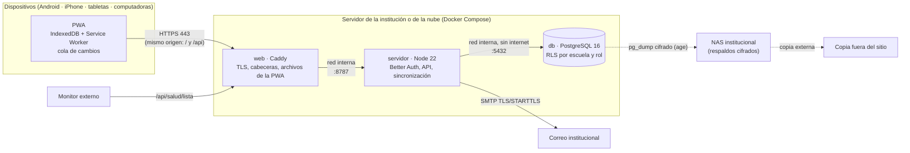
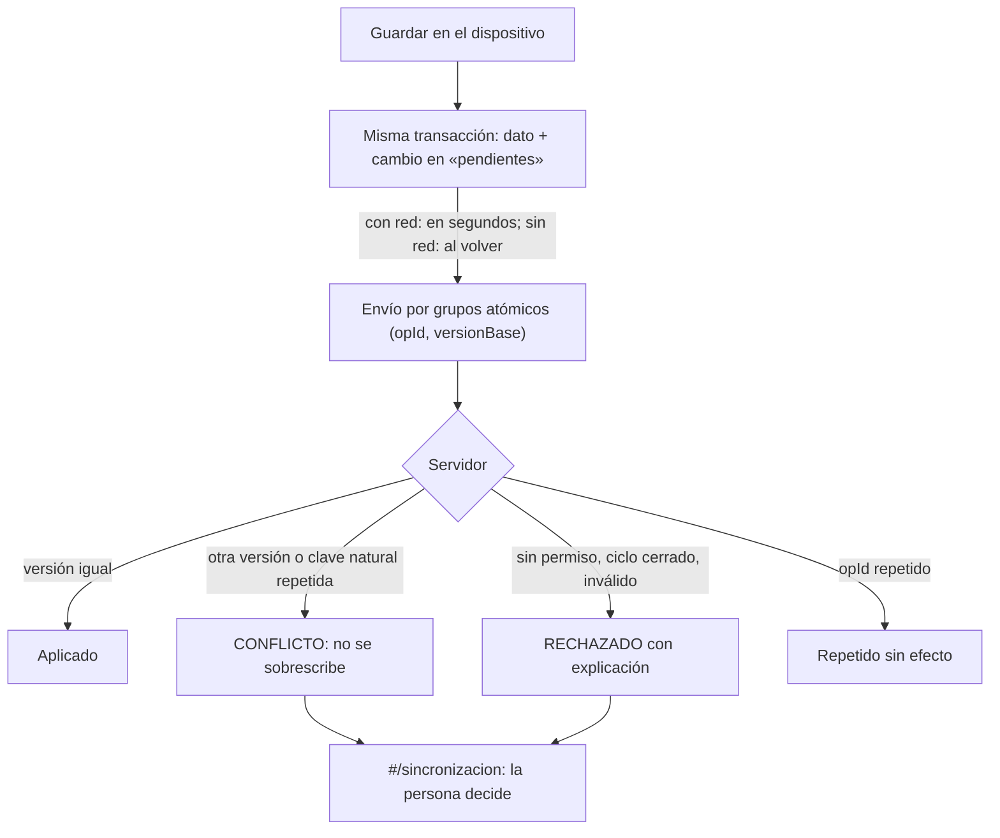

# Arquitectura de producción — Gestión Escolar (Fase 11)

Esta arquitectura **reutiliza la del proyecto**, sin cambiar de tecnología:
- PWA local-first: Vite + TypeScript + Dexie/IndexedDB.
- Servidor Node 22 con Better Auth.
- PostgreSQL 16 con RLS.

Se agrega lo necesario para operar: contenedores, un proxy con HTTPS, correo SMTP, respaldos cifrados y monitoreo. Los archivos están en `deploy/`.

**Estado:** preparada y probada en una **preproducción local** (`tests/despliegue/`). **No está publicada.**

## 1. Componentes
| Componente | Tecnología (real del proyecto) | Dónde | Notas |
|---|---|---|---|
| Cliente | PWA (HTML, CSS y JS estáticos; Service Worker; IndexedDB) | Navegador: Android, iPhone, tabletas, Windows, macOS, Linux | Funciona sin conexión; nunca guarda datos escolares en la caché del SW |
| Frontend (archivos) | `dist/` de `npm run build` | Contenedor **web** (Caddy 2) | Caché inmutable para `/assets/*`; `index.html` y `sw.js` siempre se revisan |
| Proxy inverso y HTTPS | Caddy 2 (certificados automáticos de Let's Encrypt) | Contenedor **web**, el único con puertos publicados (80/443) | Cabeceras de seguridad; `/api/desarrollo/*` cerrado; la API de administración de Caddy está apagada |
| API | Node 22 (`dist-servidor/principal.mjs`) | Contenedor **servidor**, sin puertos publicados | Usuario sin privilegios; sistema de archivos de sólo lectura; `cap_drop: ALL` |
| Autenticación | Better Auth 1.7.11: código por correo, segundo factor y, opcionalmente, Google o Microsoft | En la API | Sólo personas invitadas; sesiones en la base (revocación inmediata) |
| Autorización | `acceso.matriz` + RLS con el rol restringido `gestion_app` | PostgreSQL | Cada lectura y escritura escolar pasa por RLS |
| Base de datos | PostgreSQL 16 (migraciones `0001`–`0007` con huella) | Contenedor **db**, en una red interna **sin salida a internet** | Usuario de la app sin superusuario; `data-checksums`; SCRAM |
| Correo | SMTP institucional (nodemailer, cifrado obligatorio en producción) | Proveedor de la escuela | Sólo códigos e invitaciones; nunca se registra el contenido |
| Archivos adjuntos | **No hay almacenamiento aparte:** los adjuntos del banco de actividades (≤ 1 MB) viven en la base y viajan en los respaldos | PostgreSQL | No hace falta un servicio de objetos |
| Sincronización | Cola local (`pendientes`) → `POST /api/escuelas/:id/sincronizacion`; recepción por secuencia | PWA ↔ API | Versión base obligatoria; conflictos explícitos; idempotente |
| Respaldos | `pg_dump` + manifiesto, cifrado con age (clave **pública** en el servidor) | Servidor → NAS y copia externa | `deploy/scripts/respaldar.sh`, `verificar-respaldo.sh`, `restaurar.sh` |
| Monitoreo | `/api/salud` (vive), `/api/salud/lista` (base de datos y migraciones), `deploy/scripts/salud.sh`, registros JSON | Monitor externo y cron | Sin datos personales |
| Secretos | Archivos en `deploy/secretos/` (carpeta 700) montados como `/run/secrets/*` y leídos con `*_FILE` | Servidor | Nunca en el repositorio ni en variables visibles |

## 2. Despliegue


## 3. Petición autenticada
```mermaid
sequenceDiagram
  participant D as PWA
  participant C as Caddy
  participant A as API
  participant P as PostgreSQL
  D->>C: POST /api/... (cookie HttpOnly, Origin)
  C->>A: reenvía; X-Forwarded-For = IP real
  A->>A: Origin = URL_PUBLICA · límite por IP real · Zod
  A->>P: sesión (tabla session) y membresía
  A->>P: SET ROLE gestion_app · app.usuario_id · app.escuela_id
  P-->>A: sólo filas permitidas (RLS + acceso.matriz)
  A-->>D: respuesta sin tokens
```

## 4. Sincronización y conflictos


**Reglas por tipo de dato** (detalle en `docs/SINCRONIZACION.md`):

| Dato | Regla | Por qué |
|---|---|---|
| **Asistencia** (pase de lista y marcas) | Un pase por clase y fecha (clave natural). Una segunda lista de otro dispositivo = **conflicto**, nunca se duplica. Las correcciones llevan versión base; si otro dispositivo cambió antes = conflicto. Un borrador sin guardar se descarta, con aviso, si lo guardado cambió (INC-04) | Una marca de asistencia es un registro oficial: nunca «gana el último» |
| **Horarios** (asignaciones, sesiones, confirmaciones) | Sólo Administración, Dirección y Subdirección escriben (D14). Lo confirmado sólo se cambia reabriendo con motivo. Versión base obligatoria | Evitar cambios cruzados de varias personas |
| **Incidencias del personal** | REPORTADA → CONFIRMADA / DESCARTADA; confirmar lo hace quien tiene permiso (D5, regla en la base). Conflicto si otra persona ya la validó | No convertir inferencias en hechos |
| **Coberturas** | Asignar exige «autorizado por»; las incompatibilidades por hora real se revisan al asignar en el dispositivo y en los comandos del servidor. Conflicto si otro dispositivo cambió la cobertura | Nada se asigna solo |

**Límite conocido (MEDIO):** al sincronizar registro por registro, el servidor no vuelve a calcular los choques de horario entre docentes. Si dos personas con permiso arman horarios sin conexión en dos dispositivos, el choque no se bloquea al sincronizar. Sí aparece en «Revisión de horarios», que es de sólo lectura y no corrige nada. Mitigación: una sola persona arma los horarios de cada turno, y conviene revisar los conflictos tras sincronizar.

## 5. Entornos separados
| Entorno | Cómo | Base de datos | Datos | Correo | Candados |
|---|---|---|---|---|---|
| **Desarrollo** | `npm run dev` + `npm run servidor` | `gestion_dev` (PostgreSQL local) | Ficticios | Buzón en memoria | El buzón sólo responde a 127.0.0.1 |
| **Pruebas** | `npm test`, `test:servidor`, `test:e2e:servidor`, `test:piloto*` | `gestion_prueba_<aleatorio>`, que se crea y se borra | Ficticios | Buzón | Bases temporales; limpieza del piloto sólo en `gestion_piloto*` |
| **Preproducción** | `docker compose -p gestion-preprod … -f compose.preproduccion.yml` | `gestion_piloto_preprod` | **DEMO-001** (ficticia) | SMTP real hacia un buzón de prueba **interno** (Mailpit) | `MODO=preproduccion` exige HTTPS y SMTP como producción; `reiniciar-preproduccion.sh` sólo actúa con `MODO=preproduccion`, base `gestion_piloto*` y proyecto `gestion-preprod*` |
| **Producción** | `docker compose -p gestion-prod …` | `gestion_produccion` | Reales (**sólo con autorización**) | SMTP institucional cifrado | El servidor se niega a arrancar si la base se llama `*dev*`, `*prueba*`, `*test*`, `*piloto*`, `*demo*` o `*preprod*`, si el SMTP no va cifrado o si no hay HTTPS. Las herramientas del piloto se niegan en producción. Restaurar nunca sobrescribe |

Cada entorno tiene **su proyecto de Compose** (volúmenes y redes propios), su archivo de entorno y sus secretos.

## 6. Gestión de secretos
- `deploy/scripts/generar-secretos.sh` crea cuatro secretos aleatorios: `pg_superusuario`, `pg_gestion`, `better_auth_secret` y `database_url`. La clave SMTP la entrega el proveedor y se copia a mano en `smtp_clave`.
- **Dónde viven:** en `deploy/secretos/` (carpeta 700), excluida de git y del contexto de construcción (`.dockerignore`).
- **Cómo llegan al servidor:** se montan como `/run/secrets/*`, y el servidor los lee con `DATABASE_URL_FILE`, `BETTER_AUTH_SECRET_FILE` y `SMTP_CLAVE_FILE`.
- **Qué nunca se muestra:** un error de configuración nunca muestra el valor de un secreto (hay prueba).
- **Clave de los respaldos:** el servidor sólo guarda la clave **pública** de age. La privada vive fuera del servidor (§ `docs/RESPALDOS_PRODUCCION.md`).

## 7. Registro de errores y monitoreo
- **API:** escribe a stdout/stderr sin datos personales. Los errores inesperados se registran sin el contenido de las peticiones, y el correo no registra destinatarios ni códigos.
- **Caddy:** registro de accesos en JSON (IP, ruta y estado; sin cuerpos).
- **Auditoría de negocio:** `acceso.auditoria`, de sólo agregar.
- **Salud:**
  - `GET /api/salud` (proceso vivo);
  - `GET /api/salud/lista` (base de datos y migraciones al día; 503 si no);
  - comprobaciones de salud de Docker en `db` y `servidor`;
  - `deploy/scripts/salud.sh` para un monitor externo: PWA, API, HSTS, buzón cerrado y vencimiento del certificado.
- Detalle de alertas y umbrales: `docs/OPERACION_SERVIDOR.md` §5.

## 8. Escalabilidad
- **Varias escuelas:** el modelo ya es multiescuela. Una sola instalación atiende varias escuelas, aisladas por RLS y por el disparador de misma escuela.
- **Más carga:**
  - la API no guarda estado (las sesiones están en PostgreSQL), así que se pueden correr varias réplicas detrás de Caddy;
  - el cuello de botella previsible es PostgreSQL (RLS por fila, sin medir con volumen: B-06).
  - Antes de crecer: medir el servidor con volumen, agregar un intermediario de conexiones (PgBouncer) y, si hace falta, separar la base en un servicio administrado.
- **Crecimiento de datos (estimación desde una medición, no una garantía):** 18 050 marcas de asistencia ocupan unos 4 MB en PostgreSQL. Una escuela de 1 500 alumnos con 6 clases diarias durante ~190 días suma ~1,7 millones de marcas: **del orden de 0,5 GB por escuela y ciclo**. El respaldo cifrado comprime unas 10 veces.
