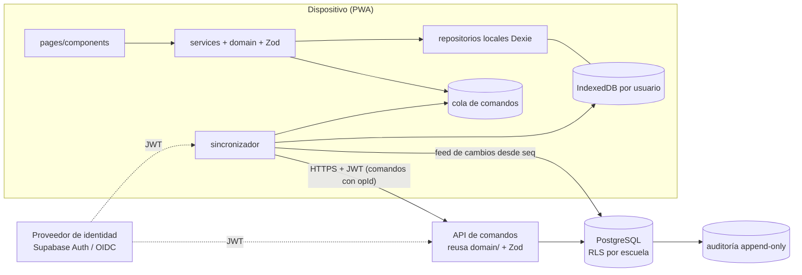

# Fase 8A — Arquitectura multiusuario y sincronización (diseño)

**Estado:** diseño propuesto, **pendiente de autorización**. No se implementó backend, no se crearon recursos externos, no se contrató ningún servicio y no se migró ningún dato.
**Fecha:** 2026-11-03 · **Alcance:** auditoría, comparación de alternativas, arquitectura, riesgos, costos estimados, plan de migración y decisiones pendientes.

> Este documento no es asesoría legal. Los apartados de privacidad deben revisarlos la Unidad de Transparencia / área jurídica de la autoridad educativa o de la escuela antes de tratar datos reales.

---

## 1. Auditoría del sistema actual

### 1.1 Hechos verificados en el código (esquema v10)
| Aspecto | Situación actual | Implicación para multiusuario |
|---|---|---|
| Almacenamiento | IndexedDB vía Dexie 4, 31 tablas, 10 versiones con migraciones que conservan datos | Buena base para una caché local por usuario |
| Identificadores | UUID generados en el cliente (`nuevoId()`), nunca nombres | **Estables y únicos globalmente**: sirven tal cual en el servidor |
| Metadatos | `creadoEn`, `actualizadoEn` (hora del dispositivo) y `version` (+1 en cada cambio) en todos los registros | `version` sirve para control de concurrencia; la hora del dispositivo **no** es confiable para ordenar |
| Aislamiento | 30 tablas llevan `escuelaId`; 26 llevan también `cicloEscolarId` (personal, alumnos, ciclos y plantillas son por escuela); `escuelas` es la raíz | La política de aislamiento por escuela se puede expresar por fila |
| Capas | `pages → services → domain/validators → repositories (interfaces) → database` | El cambio de almacenamiento se concentra en `repositories/` y en un módulo de sincronización |
| Transacciones | Toda escritura en `uow.ejecutar` (una transacción de IndexedDB) | Cada operación de negocio ya es atómica: se puede enviar al servidor como **un comando** |
| Reglas de negocio | Todas en el cliente (`services/`, `domain/`): choques por hora real, F ⇄ salida, horarios confirmados, ciclos cerrados, incompatibilidades de coberturas… | **Riesgo principal**: en un sistema compartido estas reglas deben validarse en el servidor; el cliente sólo adelanta la validación |
| Restricciones únicas locales | `pases [sesionId+fecha]`, `coberturas [sesionId+fecha]`, `inscripciones [alumnoId+cicloEscolarId]`, `adscripciones [personalId+cicloEscolarId]` | Dos dispositivos sin conexión pueden crear registros distintos para la misma clave → conflictos de unicidad que hay que resolver |
| Borrados | 36 operaciones de borrado físico en servicios | La sincronización necesita **borrado lógico** (marca de eliminación) para propagar bajas |
| «Usuario» | `ajustes.perfil-docente`: preferencia del dispositivo, **no** autenticación (así se declara en la interfaz) | No hay identidad ni permisos reales: hay que crearlos |
| Respaldos | JSON versionado, huella SHA-256, cifrado AES-GCM + PBKDF2, verificación de referencias, restauración todo o nada | Reutilizable como **paso 1 de la migración** y como formato de carga inicial |
| Registros de auditoría | `bitacora` (horarios), `movimientos` (alumnos), `cambiosAsistencia`, `bitacoraPrefectura` con `orden` | Ya existe el hábito de registrar «quién/qué/cuándo»; en el servidor debe ser obligatorio y no editable |
| Datos personales | Nombres de alumnos y personal; matrícula y CURP opcionales; reportes ≤ 280 caracteres; **sin** datos médicos ni contactos | Son datos de menores: proporcionalidad y control de acceso estrictos |

### 1.2 Dependencias entre módulos (servicios)
```
escuelas, ciclos, personal, materias, grados, alumnos, confirmacion, plantillas   (base, sin dependencias)
turnos ← horario ← conflictos ← {asignaciones, actividades}
revisionHorarios ← {personal, turnos};  vistas ← {revisionHorarios, turnos}
asistencia ← {alumnos, turnos};  panelDocente ← {vistas, turnos}
importacion ← {asignaciones, conflictos, personal, turnos};  importacionDatos ← {alumnos, grados, materias, personal}
prefectura ← {personal} (lee horarios, asistencias, actividades)
respaldos ← todas las tablas
```
Orden natural de sincronización: **escuela → ciclo → turnos/jornadas/periodos/recesos → grados/grupos → personal/materias → asignaciones/sesiones/actividades → alumnos/inscripciones → asistencia, salidas, reportes → Prefectura**. Los registros hijos nunca deben llegar antes que sus padres.

---

## 2. Requisitos del objetivo multiusuario
- Varias escuelas, turnos, docentes, Prefectura, Dirección, Subdirecciones y otros perfiles.
- Cada persona ve **sólo** lo permitido; una persona puede tener **varios roles**.
- Permisos aplicados **en el backend** (nunca ocultando botones).
- Separación por escuela, ciclo, turno, grupo y usuario.
- Seguir funcionando **sin conexión** (pase de lista, salidas, incidencias) y sincronizar después sin perder ni duplicar.
- Datos de **menores** en escuelas públicas: tratamiento mínimo, proporcional y auditable.

---

## 3. Evaluación de backend

### 3.1 Comparación técnica
| Criterio | **Supabase** (PostgreSQL gestionado + Auth + RLS) | **Firebase** (Firestore + Auth) | **Backend propio** (API + PostgreSQL) |
|---|---|---|---|
| Modelo de datos | Relacional (PostgreSQL): llaves foráneas, restricciones únicas y de exclusión, transacciones. **Coincide con el modelo actual** (31 tablas relacionadas) | Documentos/colecciones; sin llaves foráneas ni uniones; las reglas multi-documento se resuelven en código | Relacional, igual que Supabase |
| Seguridad / autorización | Row Level Security de PostgreSQL (políticas por fila evaluadas en la base) + Auth con JWT; claves de servicio deben vivir sólo en el servidor | Security Rules declarativas; potentes para propiedad de documentos, difíciles para reglas relacionales (p. ej. «docente que imparte en este grupo en este ciclo») | Total control; RLS también disponible; hay que diseñar y mantener todo |
| Autenticación | Incluida (correo + contraseña gestionada por el proveedor, enlaces mágicos/OTP, OAuth/SSO, MFA TOTP) | Incluida (muy madura; correo, OTP, Google/Microsoft, MFA con Identity Platform) | **No implementarla en casa**: usar un proveedor OIDC (Keycloak, Zitadel, Microsoft Entra ID, Google Workspace) |
| Sincronización offline | No trae una capa offline para web: se construye (cola de comandos + feed de cambios). Encaja con la capa local que **ya existe** | **Su fortaleza**: caché offline del SDK. Pero resolvería conflictos por «último en escribir gana» a nivel de campo, que **no es aceptable** para asistencia o coberturas, y duplicaría la capa Dexie existente | Igual que Supabase: se construye |
| Aislamiento entre escuelas | `escuela_id` en cada fila + políticas RLS + pruebas automáticas | Por estructura de rutas y reglas; posible, más frágil ante consultas amplias | Igual que Supabase (o una base por escuela si se exige) |
| Escalabilidad | Sobrada para el caso: miles de usuarios y decenas de GB | Muy alta, automática | Depende del diseño y de la operación |
| Residencia de datos | Regiones de Supabase en EE. UU., Canadá, Europa, Asia-Pacífico y São Paulo; **sin región en México** según su listado. Es software libre: se puede **autohospedar** en una nube con región en México | Google Cloud tiene región en México (Querétaro, `northamerica-south1`); hay que verificar qué servicios de Firebase operan ahí | Libre elección: región en México de un proveedor de nube o centro de datos institucional |
| Dependencia del proveedor | Baja: es PostgreSQL estándar; se puede migrar a otro PostgreSQL | **Alta**: modelo, reglas y SDK propietarios | Ninguna, pero alto costo propio |
| Complejidad / facilidad | Media: SQL + políticas + funciones | Baja para empezar, alta para reglas relacionales y reportes | **Alta**: servidor, autenticación integrada, despliegues, parches, respaldos, monitoreo |
| Mantenimiento | Gestionado (parches, respaldos según plan); el código de negocio es nuestro | Gestionado | Todo propio (equipo de operación) |
| Reportes / auditoría | SQL directo, vistas, exportaciones | Requiere exportar a otro motor para reportes complejos | SQL directo |

### 3.2 Costos estimados (a verificar en las páginas oficiales antes de decidir)
Escenario piloto: 1–5 escuelas, ~100–400 usuarios de personal (los alumnos **no** son usuarios), < 2 GB de datos.
| Opción | Estimación mensual | Notas |
|---|---|---|
| Supabase Pro | ≈ 25 USD por organización (incluye 100 000 usuarios activos y una instancia pequeña); más cómputo si se requiere (instancias mayores desde ≈ 110 USD) | Fuente: precios publicados 2026; las cifras de cómputo y transferencia varían entre fuentes |
| Supabase autohospedado en región México | ≈ 60–250 USD de infraestructura (VM + almacenamiento + respaldos) **+ tiempo de operación** | Mayor responsabilidad: actualizaciones de seguridad, respaldos, monitoreo |
| Firebase (Blaze) | Lecturas de Firestore desde ≈ 0.03 USD por 100 000 (edición estándar, tarifa general; la de México puede variar). Para el piloto, probablemente < 20 USD | El costo crece con lecturas; reportes y sincronizaciones completas lo elevan |
| Backend propio + PostgreSQL gestionado en México | ≈ 80–400 USD de infraestructura **+ desarrollo de autenticación integrada, API y operación** | El costo dominante es el equipo, no la infraestructura |
| Desarrollo (todas las opciones) | 8B ≈ 3–4 semanas · 8C ≈ 3 semanas · 8D ≈ 5–6 semanas · 8E ≈ 3–4 semanas (una persona) | Estimación gruesa; la sincronización es lo más costoso |

### 3.3 Recomendación
**PostgreSQL como fuente de verdad, con políticas RLS por escuela y una API de comandos que reutiliza las reglas de `domain/` y los esquemas Zod. Piloto en Supabase, diseñado para poder moverse a PostgreSQL autohospedado sin reescribir.**

Fundamentos:
1. **Encaje con el modelo**: el sistema es relacional (horarios, asignaciones, inscripciones, coberturas) y depende de restricciones únicas y validaciones entre tablas. PostgreSQL las expresa de forma nativa (llaves foráneas, `UNIQUE`, restricciones de exclusión para traslapes de horario por docente) y Firestore no.
2. **Aislamiento verificable en la base**: RLS aplica los permisos aunque haya un error en la interfaz o en una función; se puede probar automáticamente con dos escuelas ficticias.
3. **Offline correcto**: la app ya tiene una capa local robusta (Dexie, transacciones, migraciones). Conviene agregarle una cola de comandos y un feed de cambios con reglas de conflicto **por tipo de dato**, en lugar de la caché de Firestore, cuyo «último en escribir gana» podría, por ejemplo, borrar una falta registrada por otra persona.
4. **Salida del proveedor**: Supabase es PostgreSQL estándar y software libre. Si la autoridad exige residencia en México, se autohospeda o se cambia a PostgreSQL gestionado en una región mexicana con el mismo esquema y las mismas políticas.
5. **No por popularidad**: Firebase gana en facilidad inicial y en caché offline; pierde en reglas relacionales, reportes, auditoría SQL y dependencia del proveedor, que aquí pesan más.

Condición: si se decide que los datos **deben** residir en México desde el inicio (decisión D1), la opción recomendada pasa a ser **PostgreSQL en región México** (Supabase autohospedado o PostgreSQL gestionado + proveedor OIDC), con el mismo diseño.

---

## 4. Arquitectura propuesta



- **Cliente**: se conserva tal cual la arquitectura en capas. Se agregan (8D) un repositorio «sincronizable», una cola de comandos y un sincronizador. Base IndexedDB **por usuario** (`gestion-escolar-<usuario>`) para no mezclar datos en dispositivos compartidos.
- **Servidor**:
  - Tablas espejo del modelo actual (mismos UUID), más `usuarios`, `membresias`, `cambios`, `operaciones_aplicadas` y `auditoria`.
  - Las **escrituras** pasan por funciones o una API que validan con las mismas reglas de `domain/`, gracias al código TypeScript compartido.
  - Las **lecturas** pasan por RLS.
- **Nunca** se exponen claves de servicio en el cliente. El cliente sólo usa la clave pública del proyecto y el JWT del usuario.

---

## 5. Autenticación (diseño; sin contraseñas caseras)
| Tema | Diseño |
|---|---|
| Inicio de sesión | Proveedor de identidad estándar: (a) **SSO institucional** con Google Workspace o Microsoft 365 de la autoridad o la escuela, si existe (preferido); (b) correo con enlace mágico u OTP. Contraseñas, si se usan, las guarda y protege el proveedor (hash con sal), **nunca** la app |
| Alta de usuarios | Por **invitación**: un administrador crea la membresía y el sistema envía la invitación. Sin auto-registro abierto |
| Recuperación | Flujo del proveedor (enlace de un solo uso con caducidad corta). Sin preguntas secretas |
| MFA | Obligatoria (TOTP) para administrador institucional, Dirección y Subdirección; opcional para los demás |
| Sesiones | Token de acceso corto (≤ 60 min) con renovación rotatoria. «Cerrar sesión en todos los dispositivos». Tiempo máximo de sesión en dispositivos compartidos |
| Identificación | `usuarios.id` = identificador del proveedor; vínculo 1:1 con `personal.id` de cada escuela donde trabaja |
| Revocación | Desactivar la membresía en el servidor. Las políticas RLS consultan la tabla de membresías **en cada petición**, así que la revocación aplica de inmediato aunque el token siga vigente. Al reconectar, el cliente borra los datos locales de los ámbitos revocados |
| Sin conexión | La app sigue usando la última sesión válida durante un periodo de gracia configurable (p. ej. 72 h) y encola operaciones. **El servidor revalida los permisos al sincronizar**: lo que ya no esté permitido se rechaza y se informa |
| Protección | Sólo HTTPS; tokens fuera de `localStorage` cuando sea posible; CSP actual; sin datos personales en registros; límites de intentos los aplica el proveedor |

---

## 6. Autorización

### 6.1 Modelo
- `membresias(usuario_id, escuela_id, rol, alcance, vigente_desde, vigente_hasta, otorgada_por, activa)`. Una persona puede tener **varias filas**, una por rol y escuela.
- `alcance` opcional: turnos y grupos (para docentes y prefectura por turno).
- Los docentes se vinculan además con sus **asignaciones del ciclo**: ven sus grupos porque imparten en ellos, no porque lo diga una lista manual.
- La matriz se implementa con funciones SQL (`tiene_rol(escuela, rol)`, `imparte_en(grupo)`) usadas por las políticas RLS **y** por la API de comandos.

### 6.2 Matriz de permisos propuesta (L = leer, E = escribir, C = confirmar o validar)
| Recurso | Admin. institucional | Dirección | Subdirección | Prefectura | Docente | Apoyo |
|---|---|---|---|---|---|---|
| Escuela, ciclos, turnos, periodos | L E (sus escuelas) | L E | L | L | L (su escuela) | L |
| Grupos, materias, horarios | L | L E · C (confirmar horario) | L E | L | L (los suyos) | L (según función) |
| Personal (datos básicos) | L E | L E | L | L | L (nombres) | L (nombres) |
| Alumnos (identidad) | L | L E | L E | L | L (sus grupos) | L (sus casos) |
| CURP / matrícula | — | L E | L | — | — | — |
| Pase de lista, retardos | L | L | L | L | **E (sus clases)** | — |
| Salidas, reportes de alumnos | L | L | L | L E | E (sus clases) | L (Orientación / Trabajo social) |
| Incidencias del personal | L | L · C | L · C | E (reportar) | L (las propias) | — |
| Coberturas | L | L · C (autorizar) | L · C (autorizar) | E (proponer, registrar) | L (las propias) | — |
| Banco de actividades | L | L · C (validar) | L · C | E | E (proponer) | — |
| Membresías y roles | **E** | E (de su escuela, salvo administradores) | — | — | — | — |
| Auditoría | L | L (de su escuela) | — | — | — | — |
| Respaldos / exportaciones | E | E (de su escuela) | — | — | — | — |

Detalles a decidir con cada escuela (D5): quién confirma incidencias y quién autoriza coberturas. La matriz es **configurable por escuela** dentro de límites fijos (p. ej., nunca un docente ve la CURP).

---

## 7. Aislamiento de datos
- **Escuela**: todas las tablas llevan `escuela_id`. Política base: `escuela_id IN (membresías activas del usuario)`. El acceso a otra escuela sólo existe si hay membresía explícita (administrador institucional con varias escuelas).
- **Ciclo**: `ciclo_escolar_id` en datos de operación. Con el ciclo cerrado, los datos quedan en sólo lectura mediante un *trigger* (la misma regla que hoy está en `cicloEditable`).
- **Turno y grupo**: el alcance de la membresía y las asignaciones del docente restringen lo que ve.
- **Usuario**: cada registro de operación guarda `registrado_por` (usuario real, no la preferencia del dispositivo) y la base local es por usuario.
- **Pruebas obligatorias** (8C): dos escuelas ficticias con usuarios de cada rol. Para cada tabla se comprueba que un usuario no puede leer, insertar, actualizar ni borrar datos de otra escuela, turno o grupo fuera de su alcance, incluso con consultas manuales a la API.

---

## 8. Sincronización bidireccional

### 8.1 Principios
1. **Comandos, no filas sueltas**:
   - El cliente envía operaciones de negocio («guardar lista de la clase X en la fecha F», «registrar salida», «asignar cobertura») con un `opId` (UUID).
   - El servidor las ejecuta en **una transacción** con las mismas reglas, de modo que se respetan restricciones entre tablas: F ⇄ salida, choques de docente, horario confirmado.
2. **Feed de cambios**: el servidor numera cada cambio con una secuencia (`seq` creciente) y cada cliente pide «cambios de mis ámbitos desde mi última `seq`».
3. **Identificadores estables**: los UUID actuales se conservan; un mismo registro es el mismo en todos los dispositivos.
4. **Versionado**: cada fila tiene `version` asignada por el servidor y `actualizado_en` con **hora del servidor**. Los comandos de edición llevan `version_base`.
5. **Idempotencia**: la tabla `operaciones_aplicadas(op_id, usuario, resultado)` hace que reenviar un comando devuelva el mismo resultado sin repetirlo.
6. **Reintentos**: espera exponencial con variación aleatoria. Los errores de validación no se reintentan: se muestran a la persona.
7. **Borrado lógico**: las 36 operaciones de borrado pasan a marcar `eliminado_en`; el feed propaga la baja.
8. **Auditoría**: cada comando aplicado o rechazado queda en `auditoria` (usuario, rol, dispositivo, `opId`, entidad, resumen del cambio), en modo sólo agregar.

### 8.2 Cola local
Tabla `colaComandos` en IndexedDB con estos campos: `opId`, `tipo`, `datos`, `ambito` (escuela y ciclo), `versionBase`, `creadoEn` (hora del dispositivo, sólo informativa), `intentos`, `estado` (pendiente / enviado / aplicado / rechazado) y `error`.
- La operación se aplica localmente de inmediato, como hoy, y se encola en la **misma transacción**.
- La interfaz muestra un indicador honesto: «N cambios pendientes de enviar», sin afirmar que algo está sincronizado mientras no lo esté.

### 8.3 Política de conflictos por tipo de dato (no «el último gana»)
| Tipo | Ejemplos | Política |
|---|---|---|
| Hechos que sólo se agregan | salidas, movimientos, cambios de asistencia, bitácoras, incidencias reportadas | Se insertan siempre; no chocan |
| Registros con clave natural única | pase de lista (clase + fecha), cobertura (clase + fecha), inscripción (alumno + ciclo) | Si dos dispositivos crean el mismo: **fusión por campo** cuando no se contradicen (p. ej. marcas de alumnos distintos). Si se contradicen (mismo alumno F y R), se conserva la versión del servidor, la otra queda en `cambiosAsistencia` como **conflicto** y se avisa al docente para que decida |
| Configuración | horarios, periodos, grupos, materias | Concurrencia optimista: si `version_base` no coincide, se rechaza y se muestra la diferencia para volver a aplicar. No se fusiona en silencio |
| Estados validados | horario confirmado, incidencia confirmada, cobertura realizada, ciclo cerrado | Una edición sin conexión hecha sobre una versión anterior **no** los sobrescribe; se rechaza con explicación |
| Catálogos (campos independientes) | observaciones, funciones del personal | Fusión por campo si los campos modificados no se traslapan; si se traslapan, conflicto visible |
| Permisos revocados | cualquier comando | Rechazo con motivo; el comando no se pierde y queda en la lista de rechazados |

Los conflictos nunca se resuelven borrando registros: se conservan ambas versiones hasta que una persona con permiso decide.

---

## 9. Plan de migración (local → servidor)
| Paso | Procedimiento | Ya existe |
|---|---|---|
| 1. Respaldo | Respaldo **cifrado** obligatorio de cada escuela antes de migrar; se conserva fuera del dispositivo | Sí (Fase 5) |
| 2. Validar esquema | El archivo debe tener `esquema = VERSION_ESQUEMA`; verificación Zod por tabla, referencias, huella y conteos | Sí |
| 3. Preparar | Vincular la escuela local con la escuela institucional por CCT (con confirmación). Invitar a las personas (requiere correos institucionales, **dato nuevo** con aviso de privacidad). Crear membresías | No (8B/8C) |
| 4. Duplicados | Ensayo sin escritura contra el servidor. Mismo UUID = mismo registro. UUID distinto con la misma clave natural (CCT, matrícula, CURP, identificador de personal) = **posible duplicado** para revisión. **Nunca** se fusiona por nombre | Parcial (reglas de Fase 2) |
| 5. Integridad | El servidor revalida referencias, únicos, reglas de negocio y conteos por tabla | Parcial |
| 6. Autorización | Autorización escrita del responsable (Dirección o autoridad), aviso de privacidad publicado y registro del lote | No |
| 7. Migrar | Carga **por escuela en una transacción**, marcada con `lote_id`; idempotente (se puede reintentar) | No |
| 8. Validar | Comparar conteos por tabla, huellas, reportes de muestra (horario de un grupo, lista de un día, reporte de Prefectura) entre local y servidor | No |
| 9. Reversión | Hasta validar, los datos locales quedan intactos (modo «migrado, sólo lectura»). El lote del servidor se puede retirar completo por `lote_id`. El respaldo del paso 1 restaura el estado anterior | Parcial |

No se migrará información real sin la autorización del paso 6. Las pruebas usarán sólo datos ficticios.

---

## 10. Privacidad y protección de datos (México)
**Marco aplicable** (verificar vigencia y legislación estatal con el área jurídica):
- **Escuelas públicas** (sujetos obligados):
  - Aplica la **Ley General de Protección de Datos Personales en Posesión de Sujetos Obligados**, expedida en el decreto publicado en el DOF el 20 de marzo de 2025, que sustituyó a la de 2017.
  - Las funciones del INAI en esta materia pasaron a la **Secretaría Anticorrupción y Buen Gobierno**.
  - En el ámbito estatal intervienen los órganos garantes y las leyes locales.
- **Escuelas particulares**: **Ley Federal de Protección de Datos Personales en Posesión de los Particulares** (nueva, 2025).
- **Menores**: interés superior de la niñez (art. 4.º constitucional) y Ley General de los Derechos de Niñas, Niños y Adolescentes (derecho a la intimidad y a la protección de sus datos personales).

**Implicaciones de diseño:**
- **Responsable y encargados**: definir quién es el responsable del tratamiento (la escuela o la autoridad educativa). El proveedor de nube actúa como **encargado** y requiere un contrato con cláusulas de protección.
- **Transferencias**: si los servidores están fuera de México (p. ej. regiones de EE. UU. o Brasil), hay que analizar la comunicación internacional de datos. Por eso se prefiere una región en México (D1).
- **Aviso de privacidad** integral y simplificado antes de tratar datos en el servidor: finalidades (organización escolar, asistencia, horarios, Prefectura), datos tratados y su base legal.
- **Proporcionalidad**: se mantiene la política actual (sin datos médicos ni contactos; CURP opcional, visible sólo para Dirección). Los correos del personal son necesarios para la autenticación; los de alumnos **no** se piden.
- **Derechos ARCO** (acceso, rectificación, cancelación, oposición) y portabilidad: procedimiento a cargo del responsable. El sistema facilita exportar y corregir.
- **Medidas de seguridad**:
  - Documento de seguridad y análisis de riesgos.
  - Cifrado en tránsito (TLS) y en reposo (del proveedor).
  - MFA para perfiles con acceso amplio; bitácora de accesos.
  - Respaldos cifrados y plan de respuesta a vulneraciones, con notificación conforme a la ley.
- **Conservación**: plazos por tipo de dato (asistencia e incidencias por ciclo escolar más el periodo que fije la normativa); al terminar, borrado o anonimización.
- **Pruebas**: sólo datos ficticios, nunca datos reales en ambientes de desarrollo.

---

## 11. Riesgos
| Riesgo | Prob. | Impacto | Mitigación |
|---|---|---|---|
| Reglas sólo en el cliente (un cliente alterado podría saltárselas) | Alta si no se atiende | Alto | API de comandos con validación en el servidor y RLS como defensa adicional |
| Política RLS mal escrita filtra datos entre escuelas | Media | **Muy alto** | Pruebas automáticas con dos escuelas y cada rol; revisión de cada política; nada de claves de servicio en el cliente |
| Conflictos de sincronización pierden registros | Media | Alto | Comandos idempotentes, conflicto visible, borrado lógico, auditoría |
| Datos fuera de México / transferencia no analizada | Media | Alto (legal) | D1 antes de 8B; región en México o análisis jurídico |
| Acceso a datos locales tras revocar o en un dispositivo perdido | Media | Alto | Base local por usuario; borrado al revocar; sesión con caducidad; bloqueo del dispositivo; minimizar lo que se guarda sin conexión |
| Relojes de dispositivos desfasados | Alta | Medio | Ordenar con hora del servidor; la hora del dispositivo sólo como «hora declarada» |
| Migración con duplicados (dos dispositivos con la misma escuela) | Media | Medio | Ensayo sin escritura, claves naturales, revisión humana, `lote_id` para revertir |
| Costos que crecen (cómputo o lecturas) | Baja | Medio | Piloto con límites y alertas de gasto; PostgreSQL portable |
| Dependencia de una sola persona o proveedor | Media | Medio | Documentación, infraestructura como código, PostgreSQL estándar |
| Conectividad deficiente en escuelas | Alta | Medio | El modo sin conexión sigue siendo el principal; sincronización en lotes pequeños |

---

## 12. Plan de implementación (cada etapa requiere autorización expresa)
| Etapa | Entregables | Criterio de aceptación |
|---|---|---|
| **8A** (esta entrega) | Auditoría, comparación, arquitectura, riesgos, costos, plan de migración, decisiones pendientes | Revisión y decisiones D1–D10 tomadas por el usuario |
| **8B** Backend y autenticación | Proyecto de **prueba** (datos ficticios); esquema PostgreSQL espejo con migraciones versionadas; autenticación con invitación, MFA para perfiles amplios, cierre y revocación de sesión; la app inicia sesión pero sigue usando sólo datos locales | Pruebas de inicio, cierre, revocación y recuperación; nada de claves de servicio en el cliente |
| **8C** Permisos y aislamiento | Tablas `usuarios` y `membresias`; políticas RLS por tabla; funciones de permiso; API de comandos que reusa `domain/` y Zod | Batería de pruebas de aislamiento (dos escuelas × seis roles × todas las tablas) en verde |
| **8D** Sincronización sin conexión | Cola de comandos, feed por `seq`, idempotencia, borrado lógico, políticas de conflicto, indicador de pendientes, base local por usuario | Pruebas de dos dispositivos sin conexión con choques simulados; nada se pierde ni se duplica; auditoría completa |
| **8E** Migración y pruebas institucionales | Herramienta de migración en los 9 pasos; piloto con escuela(s) **ficticias** y después, sólo con autorización, una escuela real | Conteos y huellas iguales; reversión probada; aviso de privacidad publicado |

---

## 13. Decisiones pendientes (requieren al usuario o a la autoridad)
| # | Decisión | Opciones | Por qué importa |
|---|---|---|---|
| D1 | ¿Los datos deben residir en México? | Sí (PostgreSQL en región México) / no (Supabase gestionado, región más cercana) | Cambia el proveedor y el análisis legal |
| D2 | ¿Quién es el **responsable** del tratamiento? | Cada escuela / autoridad educativa estatal / otra | Define aviso de privacidad, contratos y quién administra |
| D3 | Método de inicio de sesión | SSO institucional (Google o Microsoft) / correo con enlace u OTP / ambos | Seguridad y facilidad para el personal |
| D4 | ¿Existen correos institucionales para todo el personal? | Sí / parcial / no | Necesarios para invitaciones y recuperación |
| D5 | Quién confirma incidencias y autoriza coberturas en cada escuela | Dirección / Subdirección / configurable | Matriz de permisos |
| D6 | ¿Padres, tutores o alumnos tendrán acceso? | No (recomendado por ahora) / en una fase futura | Aumenta mucho el alcance legal y técnico |
| D7 | Plazos de conservación por tipo de dato | Según la normativa que indique el área jurídica | Borrado y anonimización |
| D8 | ¿Quién es dueño de la cuenta del proveedor y quién paga? | Autoridad / escuela / proyecto | Continuidad y control |
| D9 | ¿Se mantiene un modo sólo local para escuelas que no se unan? | Sí (recomendado) / no | Compatibilidad con el uso actual |
| D10 | Escuelas piloto y fechas | — | Planeación de 8E |

---

## 14. Fuentes consultadas (noviembre de 2026)
- Supabase, regiones disponibles: <https://supabase.com/docs/guides/platform/regions>
- Supabase, precios: <https://supabase.com/pricing> · resumen 2026: <https://makerkit.dev/blog/saas/supabase-pricing>
- Firestore, precios (incluye la región México `northamerica-south1`): <https://cloud.google.com/firestore/pricing>
- Nueva legislación de datos personales (DOF 20-mar-2025): <https://idconline.mx/corporativo/2025/03/21/publican-nuevas-leyes-sobre-acceso-a-informacion-publica-y-proteccion-de-datos-personales> · <https://www.gtlaw.com/es/insights/2025/3/nueva-ley-general-proteccion-de-datos> · <https://iapp.org/news/a/entendiendo-la-ley-federal-de-protecci-n-de-datos-personales-en-posesi-n-de-los-particulares-en-mexico>
- Traspaso de funciones del INAI a la SABG: <https://www.poresto.com/mexico/2025/3/21/gobierno-formaliza-la-extincion-del-inai-y-traslada-funciones-a-nueva-secretaria-anticorrupcion-y-de-buen-gobierno.html> · padrón de sujetos obligados (acuerdo SABG, 1-oct-2025): <https://www.inah.gob.mx/images/transparencia/2025_10_01_MAT_sabg.pdf>

Los precios y la disponibilidad por región cambian: deben confirmarse en las páginas oficiales antes de contratar.
